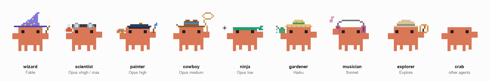
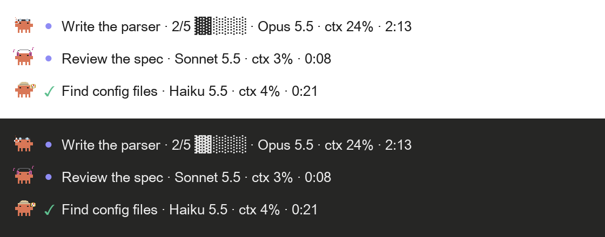

# crab-band

<p align="center">
  <picture>
    <source media="(prefers-color-scheme: dark)" srcset="docs/crabs-dark.gif">
    
  </picture>
</p>

**crab-band**, an unofficial Claude Code mod (a plugin built on function hooks) that does three things:

- **Usage limits in the status line.** Your Claude 5-hour and weekly limits, each with a gauge and a countdown to its reset:
  `5h ▓▓▓░░░░░░░ 31% ↺2h14m   7d ▓▓▓▓▓░░░░░ 52% ↺4d`. It works in the desktop app's Code tab, where a `statusLine` command is not drawn.
- **A band of crabs above the prompt.** It always leads with a row for the main session: the step it is on from its task list, a progress gauge, the model, context and turn time. Below it, a row per running subagent. Each row starts with a pixel crab dressed by model and effort, which dances while its agent works (desktop app). A finished subagent's row stays 30 seconds.

```
[crab] ● Write the parser · 2/5 ▓▓░░░░ · Opus 5.5 · ctx 24% · 2:13
[crab] ● Count hooks · Haiku 5.5 · ctx 6% · 0:15
```

- **`/agents-info`, a pane with big crabs.** The same agents on a plain background, about twice the size: the main session, the subagents running now, and every subagent that finished this session (the band keeps a finished one only 30 seconds). `/agents-info` opens or closes it, `/agents-info open` only opens it. It runs at once, even typed while Claude is working, without stopping the turn. While the pane is on screen the band steps aside, so each agent has one crab; it comes back when the pane closes or sits behind another tab.

There is also [crab-band for claude.ai](#crab-band-for-claudeai-chrome-extension), a separate Chrome extension that brings the crab to claude.ai in the browser.

The band in the desktop app (an illustration, not a screenshot):



Crab outfits:

| Agent | Crab | Dance | Props |
| --- | --- | --- | --- |
| Fable | wizard | float and twirl | waves its wand, a star blinks |
| Opus, effort max | scientist | the robot, then the boom | the flask bubbles, then blows up in a puff of smoke |
| Opus, effort xhigh | painter | sway | strokes the brush, colours appear one by one |
| Opus, effort high | doll | disco | flips her hair, the skirt flares, a sparkle twinkles, hearts float up |
| Opus, effort medium | cowboy | line dance | spins a lasso |
| Opus, effort low | ninja | back flip | the headband flutters, a throwing star spins |
| Haiku | gardener | sprinkler | tips the watering can, drops fall |
| Sonnet | musician | b-boy: toprock, headspin, freeze, hop | notes float up |
| Explore | explorer | moonwalk | glances left and right, the compass needle swings |
| anything else | plain crab | crab shuffle | |

The main row reads the task list the model keeps (the desktop app's task list, or TodoWrite in the terminal). It only reads those calls and never changes them. Between turns it rests, dimmed, on the last state.

## Requirements

- A Claude Code build with function-hook mods (an early-access API that may change between releases). Tested on Claude Code 2.1.299.
- The limits show only on a Claude Pro or Max subscription, after the session's first reply.
- The crabs are drawn in the desktop app; the terminal shows the same rows as text. In VS Code the band shows only while
  the session or a subagent is at work, as VS Code's label for it would otherwise cover the slash-command menu.

## Install

At the prompt of a terminal session:

```
/plugin install crab-band --marketplace MaxHarfen/crab-band
```

Answer `y` to add the marketplace, then pick a scope (user: every project). From a shell:

```bash
claude plugin install crab-band --marketplace MaxHarfen/crab-band
```

Start a new session afterwards. The status line and the band appear by themselves; `/agents-info` opens the pane.

## crab-band for claude.ai (Chrome extension)

A separate Chrome extension in [`chrome/`](chrome/) brings the crab to claude.ai in the browser. While Claude answers, a crab
dances and walks slowly under the reply, dressed for the model and effort in the model picker, and the 5-hour and 7-day
limits show next to the picker. It uses no tokens, asks for no permissions and runs only on claude.ai. It installs on its
own, in Chrome, and has nothing to do with the plugin install above. [chrome/README.md](chrome/README.md) says what it reads
and how to load it; [chrome/PRIVACY.md](chrome/PRIVACY.md) is its privacy policy.

## Developing

The plugin is `crab-band/`: `hooks/register.tsx` holds every hook, `hooks/crab.ts` the crab art (the ART block) and the props'
motion, `hooks/moves.ts` the dances (the MOVES block). Check it with `claude plugin validate crab-band` and `claude plugin test crab-band`.
The art and the dances each live in one place: the JSON between `// ART:BEGIN` and `// ART:END` in `crab-band/hooks/crab.ts`, and
between `// MOVES:BEGIN` and `// MOVES:END` in `crab-band/hooks/moves.ts`. A routine poses the whole crab, the body, each claw and
each leg pair over a 4-second loop, and its `box` is the view that holds every frame. Edit either block and run
`python3 docs/make_crab_gif.py docs` (it needs Pillow) to redraw the GIFs above from them; `python3 docs/make_crab_gif.py --check`
draws nothing and fails if any frame leaves its routine's box. The GIF script keeps a Python copy of the props' motion only, so a
new prop or prop animation needs adding there too.

The Chrome extension imports `crab.ts`, `moves.ts`, `costume.ts` and `limits-format.ts` from `crab-band/hooks/` when it is
built, so both draw the same crabs. After changing any of them, also run `npm test` in `chrome/`.

## License

MIT (see [LICENSE](LICENSE)).

crab-band is a fan-made mod. It is not made, endorsed or supported by Anthropic.

Credits: the crab is drawn after Clawd, Claude Code's pixel mascot, by Anthropic. crab-band began as a fork of
[johnnyvizz/claude-kit](https://github.com/johnnyvizz/claude-kit)'s savvy-progress, which had the idea of dressing
each agent's crab by its model. The outfits, their animations and the dances here are crab-band's own; the parts of the code still
adapted from savvy-progress are listed, with its MIT license, in [crab-band/NOTICE.md](crab-band/NOTICE.md).
